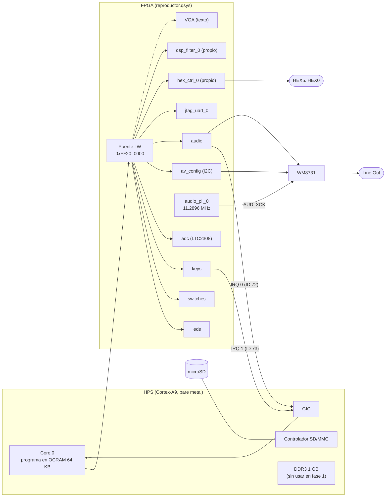

# Estado de la base del proyecto

Reproductor de audio WAV para la DE1-SoC (CE-1113 Sistemas Empotrados, Proyecto II).

La **base** es el punto de partida sobre el que se implementa el enunciado: todo el hardware del
SoC integrado en Platform Designer y compilando, con direcciones, interrupciones y pines fijos; las
herramientas para cargar código en el ARM por JTAG; y pruebas mínimas que confirman que cada bloque
responde. La funcionalidad del reproductor (filtros, lectura de la SD, metadatos, interfaz) se
construye encima.

Fecha de este estado: 2026-11-26.

---

## 1. Resumen

| Parte | Estado |
|---|---|
| HPS (ARM Cortex-A9) en bare metal, cargado por JTAG | Funciona |
| Puente lightweight HPS→FPGA | Funciona |
| LEDs, switches, botones con interrupción | Funciona |
| Audio (codec WM8731 a 44.1 kHz) | Funciona |
| ADC (potenciómetro de volumen) | Funciona |
| Controlador de 7 segmentos (hardware propio) | Funciona |
| Filtro DSP (hardware propio) | Esqueleto integrado (registros completos, paso directo); falta el filtro |
| VGA (metadatos) | Pendiente |
| Esqueleto de software del reproductor (`sw/`) | Pendiente |
| Funcionalidad del enunciado | Pendiente (ver sección 6) |

Uso actual del FPGA (fitter, 2026-11-26): **1 889 ALMs (6 %)**, 2 817 registros, 5 120 bits de
memoria en 4 bloques RAM, 0 bloques DSP, 1 PLL, 157 pines.

---

## 2. Arquitectura



Las líneas punteadas son bloques pendientes.

**Decisiones de diseño tomadas:**

| Decisión | Motivo |
|---|---|
| El HPS es el único procesador; no se usa Nios V | La microSD solo está cableada al HPS, así que el ARM es obligatorio. Un segundo procesador no tendría una función justificada |
| Fase 1: el programa corre en la **OCRAM** (64 KB) y se carga por JTAG | Probado: sin preloader, el depurador y el CPU acceden a toda la OCRAM. No hace falta inicializar la DDR3 ni tocar la SD con las canciones |
| Codec fijo a **44.1 kHz** | El WM8731 no tiene modo de 16 kHz. Con una sola frecuencia, los WAV de 44.1 kHz suenan sin remuestrear, los filtros usan un solo juego de coeficientes y no se reconfigura el codec entre canciones. Los WAV de 8 y 16 kHz se remuestrean en software |
| ADC **LTC2308** en vez de AD7928 | La placa del grupo es rev. F/G, que trae el LTC2308. El IP y el mapa de registros son los mismos |
| 4 botones para 5 controles | KEY0 = play/pausa (alterna), KEY1 = stop, KEY2 = anterior, KEY3 = siguiente |

---

## 3. Hardware: estado de cada módulo

Todos los periféricos de la FPGA están en el puente lightweight. La dirección para el ARM es
`0xFF20_0000` + offset.

| Módulo | Offset | IRQ (`f2h_irq0` → GIC ID) | Estado | Verificado con |
|---|---|---|---|---|
| `hps_0` | — | — | Funciona | `tests/inc0-hps/` |
| `clk_0` | — | — | Funciona | — |
| `leds` | `0x0000` | — | Funciona | `tests/io-adc/` |
| `hex_ctrl_0` (propio) | `0x0020` | — | Funciona | `tests/hw/`, `tests/hex-dsp/` |
| `switches` | `0x0040` | — | Funciona | `tests/io-adc/` |
| `keys` | `0x0050` | 1 → 73 | Funciona | `tests/io-adc/` |
| `jtag_uart_0` | `0x1000` | — | Funciona | todas las pruebas |
| `av_config` | `0x3000` | — | Funciona | `tests/inc2-audio/` |
| `audio` | `0x3040` | 0 → 72 | Funciona | `tests/inc2-audio/` |
| `audio_pll_0` | — | — | Funciona | `tests/inc2-audio/` |
| `adc` | `0x4000` | — | Funciona | `tests/io-adc/` |
| `dsp_filter_0` (propio) | `0x5000` | — | Esqueleto (paso directo) | `tests/hw/`, `tests/hex-dsp/` |
| VGA (Character Buffer) | por definir | — | **Pendiente** | — |

### 3.1 `hps_0` — Hard Processor System

El ARM Cortex-A9 que ejecuta todo el software. Configuración relevante:

- **DDR3:** 1 GB a 400 MHz, 32 bits (parámetros de la GHRD de Terasic). No se usa en la fase 1,
  pero debe estar bien configurada para que el fitter ubique los pines y para la fase 2.
- **Pines del HPS:** SD/MMC (HPS I/O Set 0, 4 bits) para la microSD y UART0 (Set 0) para la fase 2.
  Son pines dedicados: no ocupan la FPGA.
- **Interfaces con la FPGA:** solo el puente **lightweight** (maestro hacia los periféricos) y las
  **interrupciones FPGA→HPS**. Los puentes completos y los puertos FPGA→SDRAM están deshabilitados
  porque ningún bloque de la FPGA necesita acceder a la memoria del HPS.
- **Reset:** `h2f_reset` alimenta el reset de toda la lógica de la FPGA, que sale de reset junto con
  el HPS.

Antes de usar los periféricos, el software debe sacar los puentes de reset (`0xFFD0501C` = 0) y
habilitarlos en el L3 (`0xFF800000` |= `0x18`). Sin SD, el BootROM deja activo un watchdog que hay
que retener en reset (`0xFFD05014` |= `0x40`).

### 3.2 `leds` — PIO de salida, 10 bits

LEDR[9:0]. Uso previsto: indicar el filtro activo y el estado de reproducción (requisito "estado
de filtros: indicación visual").

### 3.3 `switches` — PIO de entrada, 10 bits

SW[9:0], leídos por sondeo. Uso previsto: selección del filtro activo. Con un ciclo de sondeo de
pocos milisegundos se cumple el requisito de cambio de filtro en menos de 100 ms.

### 3.4 `keys` — PIO de entrada con interrupción, 4 bits

KEY[3:0]. Captura flancos de bajada (los botones son activos en bajo y la placa ya les quita el
rebote), con limpieza bit a bit del registro de captura e interrupción por flanco. Registros:
datos `+0x0`, máscara de interrupción `+0x8`, captura de flancos `+0xC` (se limpia escribiendo 1
en cada bit).

### 3.5 `jtag_uart_0` — consola de depuración

Consola de texto por el mismo cable USB-Blaster (`scripts/general/terminal.sh`). Se usa porque
en la fase 1 no hay preloader que configure la UART0 del HPS. **Hay que justificarlo en la
documentación o quitarlo antes de la entrega** (requisito: no se permiten componentes sin
funcionalidad justificada).

### 3.6 `audio_pll_0`, `av_config` y `audio` — cadena de audio

| Módulo | Función | Configuración |
|---|---|---|
| `audio_pll_0` (Audio Clock) | Genera el reloj maestro del codec (`AUD_XCK`) | 11.2896 MHz desde los 50 MHz |
| `av_config` (Audio and Video Config) | Configura el WM8731 por I2C al arrancar | 16 bits, Left Justified, Line In sin bypass, *Sampling Rate* 48 kHz (el IP no ofrece 44.1 kHz; con 11.2896 MHz el codec queda en 11.2896 MHz / 256 = 44.1 kHz) |
| `audio` (Audio Core) | FIFOs de 128 muestras por canal hacia el codec | Memory-mapped, solo salida, 16 bits |

Registros del Audio Core: control `+0x0` (bit 1 = interrupción de escritura, bit 3 = vaciar FIFOs
de salida), `fifospace` `+0x4` (bits 31:24 y 23:16 = espacio libre izquierdo/derecho), datos
izquierdo `+0x8` y derecho `+0xC`. La interrupción (ID 72) servirá para llenar el FIFO sin sondeo.

Ajuste pendiente: en `av_config`, *DE Board* quedó en **DE10-Standard**. Funciona porque esa
placa usa el mismo codec, pero conviene cambiarlo a DE1-SoC.

### 3.7 `adc` — ADC Controller for DE-series Boards (LTC2308)

Lee el potenciómetro de volumen en el canal 0 (12 bits). Configurado para DE1-SoC rev. F+, 1 canal,
reloj de 12.5 MHz. Se habilita la conversión continua escribiendo 1 en `+0x4`; el canal 0 se lee
en `+0x0` (bits 11:0). Con el potenciómetro de 10 kΩ entre GND y 3.3 V se lee de 0 a ~3300.

### 3.8 `hex_ctrl` — controlador de 7 segmentos (hardware propio)

Componente Avalon-MM escrito por el grupo en SystemVerilog (`Reproductor/ip/hex_ctrl/`). El software escribe el
tiempo en binario y el hardware hace la conversión a decimal y a 7 segmentos: MM:SS en HEX3–HEX0 y
número de canción en HEX5–HEX4. Cumple el requisito de manejo de los displays en hardware.

| Offset | Registro | Acceso | Contenido |
|---|---|---|---|
| `0x0` | CTRL | RW | bit 0 = encender HEX3–0 (tiempo), bit 1 = encender HEX5–4 (canción) |
| `0x4` | TIEMPO | RW | bits 14:8 minutos (0–99), bits 5:0 segundos (0–59) |
| `0x8` | CANCION | RW | bits 6:0 número de canción (0–99) |
| `0xC` | STATUS | R | bit 0 = el último valor estaba fuera de rango (se muestra saturado); bits 31:16 = ID `0x4E58` |

Verificado en simulación (`tests/hw/`, 8 casos) y en la placa (`tests/hex-dsp/`).

### 3.9 `dsp_filter` — filtro DSP (hardware propio, esqueleto)

El filtro obligatorio en HDL propio, en SystemVerilog (`Reproductor/ip/dsp_filter/`). La interfaz de registros ya está
completa; el procesamiento todavía deja pasar la muestra sin cambios. El filtro real (por ejemplo
un FIR con multiplicador-acumulador) se escribe en el bloque `PROCESAMIENTO` de `dsp_filter.sv` sin
cambiar el mapa de registros.

| Offset | Registro | Acceso | Contenido |
|---|---|---|---|
| `0x00` | CTRL | RW | bit 0 EN (1 = filtrar, 0 = bypass), bit 1 LIMPIAR (borra el estado), bit 2 CANAL (0 = izq., 1 = der.) |
| `0x04` | STATUS | R | bit 0 LISTO, bit 1 OCUPADO |
| `0x08` | DATA_IN | RW | muestra de 16 bits con signo; escribirla inicia el procesamiento |
| `0x0C` | DATA_OUT | R | resultado de 16 bits con signo |
| `0x10` | COEF_IDX | RW | índice del coeficiente |
| `0x14` | COEF_DATA | RW | coeficiente Q1.15 en la posición COEF_IDX |
| `0x18` | INFO | R | ID `0xD5F1`, versión (`0x01` = esqueleto), número de coeficientes (16) |

Uso por muestra: escribir DATA_IN → esperar STATUS.LISTO → leer DATA_OUT. Verificado en
simulación (`tests/hw/`, 5 casos) y en la placa (`tests/hex-dsp/`).

### 3.10 VGA — metadatos en pantalla (pendiente)

IP del University Program: *Video Clocks for DE-series Boards* (25 MHz), *Character Buffer* (texto
de 80×60 en memoria interna) y *VGA Controller*. Mostrará título, artista, álbum, duración, número
de canción, estado y filtro activo.

---

## 4. Software: lo que existe

| Ruta | Contenido |
|---|---|
| `scripts/hps/gdb-server.sh` | Arranca el gdb-server de Ashling (incluido en Quartus) para el Cortex-A9 |
| `tests/inc0-hps/` | Arranque mínimo (`start.S`), linker script de la OCRAM (`ocram.ld`), script de carga con gdb (`cargar.gdb`) y prueba de acceso a la OCRAM |
| `tests/inc2-audio/` | Tono de 441 Hz por Line Out; verifica que el codec va a 44.1 kHz |
| `tests/hw/` | Testbenches autoverificables de `hex_ctrl` y `dsp_filter` en Questa (`sim.sh`) |
| `tests/hex-dsp/` | `hex_ctrl` y `dsp_filter` en la placa: cronómetro en los displays y paso directo del filtro |
| `tests/io-adc/` | Arranque con interrupciones (vectores, pila IRQ), configuración del GIC, botones por IRQ, switches y ADC |

Todo usa acceso directo a registros, sin HAL. Flujo de trabajo:

```bash
cd Reproductor && make hw && make prog          # hardware
scripts/hps/gdb-server.sh                         # terminal 1
gdb-multiarch -x tests/inc0-hps/cargar.gdb X.elf  # terminal 2: carga y para en main
scripts/general/terminal.sh                       # terminal 3: consola JTAG UART
```

---

## 5. Software del reproductor: módulos a construir

Estructura propuesta para `Reproductor/sw/` (reemplaza el código viejo del Nios V):

```
sw/
├── arranque/      start.S (vectores, pilas por modo, watchdog), ocram.ld
├── drivers/       un archivo por periférico, solo acceso a registros
│   ├── hps.c          puentes HPS→FPGA, watchdog
│   ├── gic.c          configuración del GIC y despacho de interrupciones
│   ├── sdmmc.c        controlador SD/MMC del HPS (lectura de bloques)
│   ├── audio.c        Audio Core: FIFOs, interrupción de escritura
│   ├── av_config.c    acceso al codec por I2C (si hace falta ajustar algo en tiempo de ejecución)
│   ├── adc.c          lectura del canal 0
│   ├── keys.c         botones: máscara y captura de flancos
│   ├── switches.c, leds.c, jtag_uart.c
│   ├── hex.c          hex_ctrl
│   ├── dsp.c          dsp_filter
│   └── vga.c          Character Buffer
├── reproductor/
│   ├── fat.c          sistema de archivos FAT32 sobre sdmmc.c (lista de .wav)
│   ├── wav.c          parser WAV: formato, frecuencia, tamaño, chunk LIST/INFO (metadatos)
│   ├── remuestreo.c   8/16 kHz → 44.1 kHz por interpolación lineal
│   ├── filtros.c      filtros en software + selección (incluye el filtro en hardware vía dsp.c)
│   ├── volumen.c      escala de las muestras según el ADC
│   ├── player.c       máquina de estados: detenido / reproduciendo / pausado, siguiente/anterior,
│   │                  avance automático, tiempo transcurrido
│   └── ui.c           VGA, 7 segmentos, LEDs; atención de botones y switches
└── main.c
```

| Módulo | Qué hace | Requisito que cubre |
|---|---|---|
| `arranque/` | Tabla de vectores, pilas de los modos SVC e IRQ, `.bss`, salto a `main` | Base de todo; gestión de memoria |
| `gic.c` | Habilita las IRQ 72 (audio) y 73 (botones), atiende y despacha | Botones por interrupción |
| `sdmmc.c` + `fat.c` | Lee bloques de la microSD con el controlador del HPS e interpreta FAT32 para listar y abrir los `.wav` | SD mediante el HPS; ≥10 canciones |
| `wav.c` | Valida el formato (PCM, 16 bits, 8/16/44.1 kHz) y extrae título, artista y álbum del chunk `LIST/INFO`; la duración sale del tamaño de datos | Formatos; metadatos |
| `remuestreo.c` | Convierte 8 y 16 kHz a 44.1 kHz | Formatos (el codec trabaja fijo a 44.1 kHz) |
| `filtros.c` + `dsp.c` | Al menos 3 filtros seleccionables por switches; uno es el `dsp_filter` en hardware | Filtros digitales; latencia < 100 ms |
| `volumen.c` | Multiplica las muestras por un factor que sale del ADC | Control de volumen |
| `audio.c` | Llena el FIFO del Audio Core por interrupción | Reproducción sin cortes |
| `player.c` | Estados, transiciones, avance automático, cambio de canción | Controles; reproducción continua; cambio de canción < 2 s |
| `ui.c` | Muestra tiempo (7 segmentos), metadatos, número de canción, estado y filtro (VGA, LEDs) | Visualización |

---

## 6. Qué falta

### 6.1 Para cerrar la base

- [x] `hex_ctrl`: HDL, componente en Platform Designer, pines HEX0–HEX5.
- [x] `dsp_filter`: esqueleto HDL (registros y paso directo), componente en Platform Designer y
      *testbench* inicial.
- [ ] VGA: Video Clocks + Character Buffer + VGA Controller, pines VGA.
- [ ] `av_config`: cambiar *DE Board* a DE1-SoC.
- [ ] Esqueleto `sw/` con la estructura de la sección 5 (funciones declaradas y vacías) y targets
      `make sw` y `make load` en `Reproductor/Makefile`.
- [ ] Prueba de humo de la base completa.

### 6.2 Funcionalidad del enunciado (sobre la base)

| Requisito | Módulo | Estado |
|---|---|---|
| ≥10 canciones WAV en la SD, leídas por el HPS | `sdmmc.c`, `fat.c` | Pendiente |
| WAV 16 bits a 8, 16 y 44.1 kHz | `wav.c`, `remuestreo.c` | Pendiente |
| Metadatos: título, artista, álbum, duración | `wav.c` | Pendiente (los WAV deben llevar chunk `LIST/INFO`, por ejemplo con `ffmpeg -metadata`) |
| Play, pausa, stop, anterior, siguiente por botones con interrupción | `player.c`, `keys.c`, `gic.c` | Hardware listo; lógica pendiente |
| Estado de reproducción visible | `ui.c` | Pendiente |
| Reproducción continua (siguiente canción al terminar) | `player.c` | Pendiente |
| Tiempo MM:SS en 7 segmentos (hardware) | `hex_ctrl`, `hex.c` | Hardware listo; falta llevar el tiempo de reproducción |
| Metadatos, número de canción y filtro en pantalla | VGA, `ui.c` | Pendiente |
| ≥3 filtros por switches, uno en HDL propio | `dsp_filter`, `filtros.c` | Interfaz del filtro en hardware lista; faltan los filtros |
| Cambio de filtro < 100 ms; bypass sin distorsión | `filtros.c` | Pendiente |
| Volumen con potenciómetro (ADC) | `adc.c`, `volumen.c` | Hardware listo; lógica pendiente |
| Respuesta a botones < 200 ms; cambio de canción < 2 s | `player.c` | Pendiente |
| Sistema funcionando en < 10 s tras el reset | Fase 2 | Pendiente: con carga por JTAG un reset borra el programa |

### 6.3 Entregables y cierre

- [ ] **Fase 2:** arranque desde la SD (preloader + programa en la tarjeta) para cumplir el tiempo
      de inicio tras el reset.
- [ ] Verificación aislada del `dsp_filter` (*testbench*, casos y resultados documentados).
- [ ] Reporte de recursos (sistema completo y `dsp_filter` por separado) y de potencia
      (PowerPlay Power Analyzer), con la discusión de la partición hardware/software.
- [ ] Justificar o quitar `jtag_uart_0`.
- [ ] Documentos de diseño: software, metodología (incluye las decisiones de la sección 2),
      hardware propio (diagrama de bloques, registros, mapa de memoria, diagramas de tiempo).
- [ ] README final con instalación, compilación, uso, diagramas, evidencias de los filtros,
      capturas y videos.
