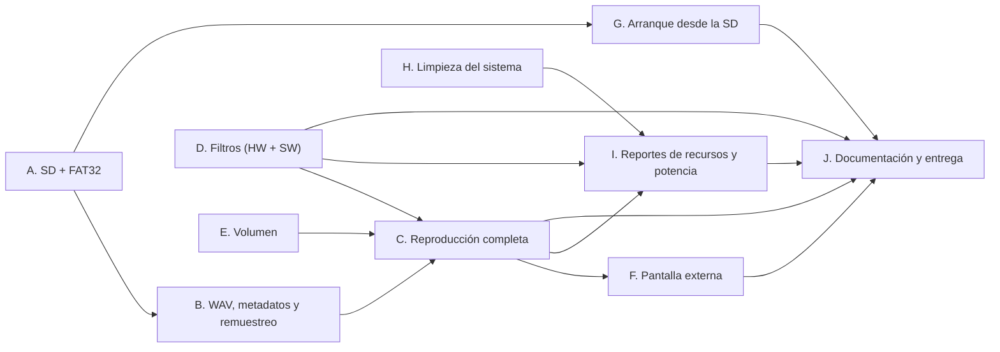

# Lo que falta: tareas para el grupo

La base está lista y probada en la placa: todo el hardware integrado en Platform Designer, el
esqueleto de software corriendo en el ARM y una prueba por cada bloque (ver [`README.md`](README.md)).
Este documento divide el trabajo restante en paquetes independientes para repartirlos.

**Entrega: 2 de diciembre de 2026.** Prioridad: primero lo que bloquea la demostración
(reproducir canciones de la SD con filtros), después pantalla, arranque desde SD, reportes y
documentación.

---

## 1. Mapa de dependencias

A, D, E, F y H pueden empezar ya, en paralelo. B depende de A (aunque el parser WAV se puede
escribir y probar antes con un arreglo en memoria). C integra todo.

---

## 2. Paquetes de trabajo

Cada paquete indica archivos, qué hay que hacer y cuándo se considera terminado. Sugerencia: un
issue de GitHub por paquete (o por viñeta grande) y una rama `feature/...` por issue.

### A. Lectura de la microSD (SD/MMC + FAT32) — riesgo alto, empezar ya

**Archivos:** `Reproductor/sw/drivers/sdmmc.c/.h`, `Reproductor/sw/reproductor/fat.c/.h`

- [ ] `sdmmc_iniciar()`: inicializar la tarjeta con el controlador SD/MMC del HPS (`0xFF704000`):
      CMD0, CMD8, ACMD41, CMD2, CMD3, CMD7, cambio a bus de 4 bits. Referencia: *Cyclone V HPS
      Technical Reference Manual*, capítulo SD/MMC. En la fase 1 el BootROM ya dejó reloj y pines
      del controlador configurados al intentar arrancar desde la SD (hay que comprobarlo).
- [ ] `sdmmc_leer()`: lectura de bloques de 512 bytes (CMD17/CMD18) desde el FIFO del controlador.
- [ ] `fat_montar()`: MBR → primera partición FAT32 → sector de arranque (BPB).
- [ ] `fat_contar_wav()`, `fat_nombre_wav()`, `fat_abrir_wav()`, `fat_leer()`: recorrer el
      directorio raíz y la cadena de clusters.
- **Terminado cuando:** con una SD de prueba, la consola lista los ≥10 `.wav` y se puede leer
  cualquiera de principio a fin comparando unos bytes con la PC.
- **Ojo:** la memoria es la OCRAM (64 KB): un bloque o un cluster de buffer, no archivos enteros.
  Si se quiere usar una biblioteca FAT (por ejemplo FatFs) con un `diskio` propio sobre `sdmmc.c`,
  consultarlo antes con el profesor (el enunciado pide minimizar bibliotecas de abstracción).

### B. WAV, metadatos y remuestreo

**Archivos:** `Reproductor/sw/reproductor/wav.c/.h`, `remuestreo.c/.h`, script de canciones

- [ ] `wav_abrir()`: validar `RIFF`/`WAVE`, chunk `fmt ` (PCM, 16 bits, mono/estéreo, 8/16/44.1 kHz),
      buscar `LIST`/`INFO` (`INAM` título, `IART` artista, `IPRD` álbum) y `data`; calcular la
      duración.
- [ ] `remuestreo`: interpolación lineal 8 kHz y 16 kHz → 44.1 kHz (el codec trabaja fijo a 44.1 kHz).
      Mono → estéreo duplicando la muestra.
- [ ] Script (por ejemplo `scripts/canciones/preparar.sh`) que convierta audios a WAV 16 bits con
      metadatos usando `ffmpeg -metadata title=... artist=... album=...`, en las tres frecuencias.
- [ ] Preparar la SD de demostración: ≥10 canciones, al menos una en 8 kHz y otra en 16 kHz.
- **Terminado cuando:** la consola imprime frecuencia, canales, duración, título, artista y álbum
  de cada canción, y las de 8/16 kHz suenan a la velocidad correcta.

### C. Reproducción completa

**Archivos:** `Reproductor/sw/reproductor/player.c`, `Reproductor/sw/main.c`, `drivers/audio.c`

- [ ] Reemplazar `tono_siguiente()` por las muestras del WAV (lectura con doble buffer desde la SD).
- [ ] Audio por interrupción (`IRQ_AUDIO`, GIC ID 72) en vez de sondeo, para no cortar mientras se
      lee la SD.
- [ ] Al cambiar de canción: cerrar, abrir el siguiente WAV y leer metadatos (< 2 s).
- [ ] Reproducción continua: al terminar una canción pasar a la siguiente.
- [ ] Estéreo real: canal izquierdo y derecho por separado por filtros y volumen.
- **Terminado cuando:** play/pausa/stop/anterior/siguiente funcionan con canciones reales, sin
  cortes audibles, y el tiempo en los displays coincide con el de la canción.

### D. Filtros — los tres en hardware propio

**Archivos:** `Reproductor/ip/dsp_filter/dsp_filter.sv`, `tests/hw/tb_dsp_filter.sv`,
`Reproductor/sw/reproductor/filtros.c`

Los tres filtros van en `dsp_filter` (hardware propio); ninguno en software. Todos usan el mismo
núcleo: una cascada de 3 biquads (IIR de segundo orden) que solo cambia en los coeficientes.
SW[1:0]: 0 = bypass, 1 = pasa-altos, 2 = pasa-banda, 3 = ecualizador de 3 bandas.

- [x] Elegir y diseñar los filtros: pasa-altos IIR (800 Hz), pasa-banda (300–3000 Hz) y
      ecualizador de 3 bandas. Diseño en Python, comparación FIR contra IIR y modelo bit-exacto en
      punto fijo con vectores de prueba ([`dsp/README.md`](dsp/README.md)).
- [ ] **Filtro en hardware:** implementar el núcleo biquad en `dsp_filter.sv` (un solo archivo:
      MAC secuencial, estado separado por canal, redondeo y saturación como el modelo). Subir
      `VERSION` a `0x02`.
- [ ] Testbench: comparar la salida contra los vectores del modelo en Python (impulso, escalón,
      senos, saturación, chirp, ruido). Documentar casos y resultados en `tests/hw/README.md`
      **antes** de integrar (lo exige el enunciado).
- [ ] `filtros.c` y `dsp.c`: al cambiar SW[1:0], cargar los coeficientes del filtro elegido en
      `dsp_filter` y procesar los dos canales (bit CANAL de CTRL).
- [ ] Medir que el cambio de filtro es < 100 ms y que el bypass no distorsiona.
- [ ] Extensión (crédito extra, confirmar con el profesor): ecualizador de 5 bandas con el mismo
      núcleo biquad.
- **Terminado cuando:** con SW[1:0] se escuchan claramente los 4 modos y hay evidencia (gráficas
  de respuesta en frecuencia, capturas) para el README.

### E. Volumen

**Archivos:** `Reproductor/sw/reproductor/volumen.c`

- [ ] Curva logarítmica (tabla) en vez de lineal; filtrar el ruido del ADC (±3 cuentas).
- **Terminado cuando:** el volumen cambia de forma pareja en todo el recorrido del potenciómetro.

### F. Pantalla externa con metadatos — requisito, pospuesto en la base

- [ ] Elegir la pantalla (VGA es la opción natural en la DE1-SoC; la placa no trae LCD).
- [ ] Platform Designer: *Video Clocks for DE-series Boards* (25 MHz), *Character Buffer* y *VGA
      Controller* del University Program; pines VGA; dirección libre en el puente LW.
- [ ] Driver `drivers/vga.c` y `ui.c`: título, artista, álbum, duración, canción N/M, estado y filtro.
- **Terminado cuando:** la pantalla muestra la información de la canción actual y se actualiza al
  cambiar de canción, estado o filtro.

### G. Arranque desde la SD (< 10 s tras el reset)

Con la carga por JTAG, un reset borra el programa, así que este requisito necesita la fase 2.

- [ ] Preloader: U-Boot SPL para la DE1-SoC (`socfpga_de1_soc_defconfig` de U-Boot; usa la misma
      configuración de DDR3 que el sistema, tomada de la GHRD de Terasic).
- [ ] SD con una partición tipo `A2` (preloader + programa) y la partición FAT32 con las canciones.
- [ ] El programa debe arrancar solo: revisar que `start.S` no dependa de nada que hoy hace gdb.
- [ ] Programar la FPGA desde la SD o desde la memoria de configuración, para no depender de la PC.
- **Terminado cuando:** con la placa desconectada de la PC, al encender o presionar reset el
  reproductor está listo en < 10 s.

### H. Limpieza del sistema

- [ ] `av_config`: cambiar *DE Board* de DE10-Standard a DE1-SoC.
- [ ] `jtag_uart_0`: justificarlo en la documentación (depuración) o quitarlo antes de la entrega.
- [ ] Borrar `Reproductor/ip/presets/NewPreset_1.qprs` (DDR3 genérica, no corresponde a la placa).
- [ ] Renombrar `tests/inc0-hps/` e `tests/inc2-audio/` a nombres descriptivos y actualizar referencias.

### I. Reportes de recursos y potencia

- [ ] Recursos del sistema completo y del `dsp_filter` por separado (ALMs, registros, memoria,
      bloques DSP): `Reproductor/output/reproductor.fit.rpt`, *Resource Utilization by Entity*.
- [ ] Potencia del sistema con *PowerPlay Power Analyzer* (`quartus_pow`).
- [ ] Análisis: costo en recursos de tener el filtro en hardware frente a software.

### J. Documentación y entrega

- [ ] Documento de diseño de software: módulos, API de cada driver y módulo, requisitos y lista de
      cumplimiento (usar la tabla de requisitos de [`README.md`](README.md), sección 6.2).
- [ ] Metodología de diseño: alternativas evaluadas y justificación de la partición HW/SW (las
      decisiones están en [`README.md`](README.md), sección 2).
- [ ] Hardware propio: diagrama de bloques, registros, mapa de memoria, diagramas de tiempo de
      `dsp_filter` y `hex_ctrl`.
- [ ] Herramientas de ingeniería: scripts y modelos creados (Makefile, `scripts/`, diseño de filtros).
- [ ] README final: instalación, compilación, uso, diagramas de arquitectura, evidencias de los
      filtros, capturas y video de demostración.
- [ ] Presentación funcional (60 % de la nota).

---

## 3. Reparto sugerido

Ajustar al tamaño del grupo. Con cuatro personas, por ejemplo:

| Persona | Paquetes | Perfil |
|---|---|---|
| 1 | A, luego G | Bajo nivel del HPS (registros SD/MMC, arranque) |
| 2 | B, luego C | Formatos de archivo, flujo de audio, integración |
| 3 | D (diseño, hardware, testbench y `filtros.c`), luego I | HDL y DSP |
| 4 | E, F, H | Software y Platform Designer |
| Todos | J | Cada uno documenta lo suyo; una persona consolida |

Una sola persona a la vez debe modificar `reproductor.qsys` (ver la guía de colaboración).

---

## 4. Requisitos del enunciado y su estado

| Requisito | Paquete | Estado |
|---|---|---|
| ≥10 canciones WAV en la SD, por el HPS | A, B | Pendiente |
| WAV 16 bits, 8/16/44.1 kHz | B | Pendiente |
| Metadatos: título, artista, álbum, duración | B, F | Pendiente |
| Botones con interrupción: play, pausa, stop, anterior, siguiente | C | Base lista (botones e IRQ funcionan; falta con canciones reales) |
| Estado de reproducción visible | F | Parcial (LEDs y consola) |
| Reproducción continua | C | Pendiente |
| Tiempo MM:SS en 7 segmentos, manejado por hardware | — | **Hecho** (`hex_ctrl`) |
| Metadatos, número de canción y filtro en pantalla externa | F | Pendiente |
| ≥3 filtros por switches, uno en HDL propio verificado aisladamente | D | Los tres en hardware: diseño y modelo listos; falta el HDL |
| Cambio de filtro < 100 ms; bypass sin distorsión | D | Pendiente de medir |
| Volumen con potenciómetro por el ADC | E | Básico funcionando |
| Audio por la FPGA (IP de audio), no por el HPS | — | **Hecho** |
| Respuesta a botones < 200 ms; cambio de canción < 2 s | C | Pendiente de medir |
| Operativo en < 10 s tras el reset | G | Pendiente |
| Sin componentes injustificados | H | Pendiente (`jtag_uart_0`) |
| Reporte de recursos y potencia | I | Pendiente |
| Documentación, README, Git (convención de commits, ramas, issues) | J | En curso |
