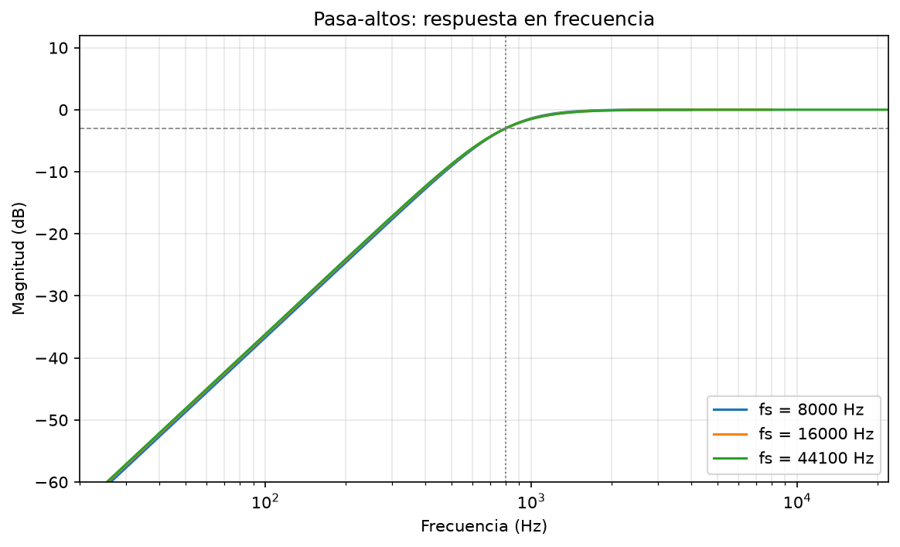
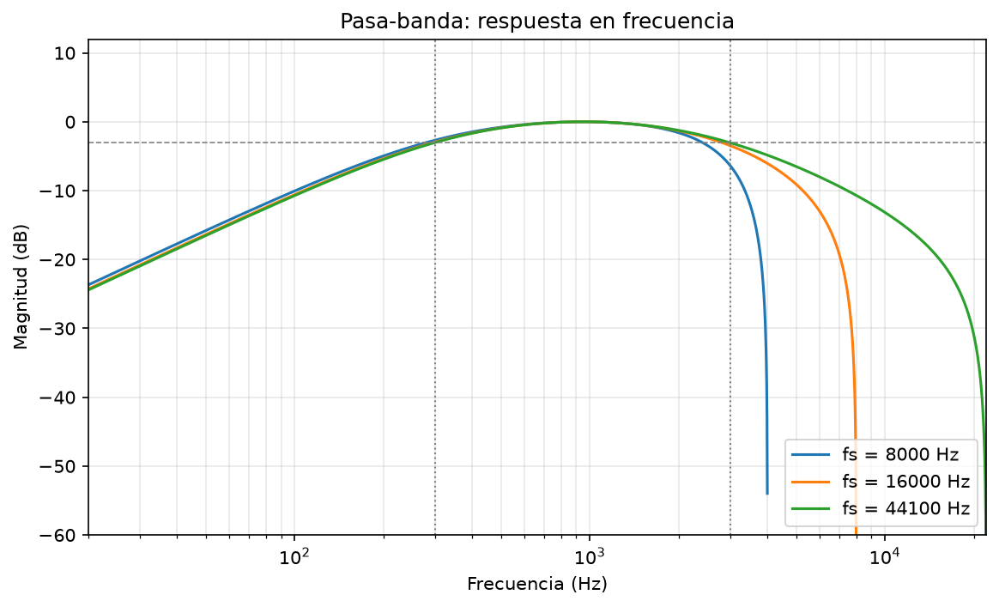
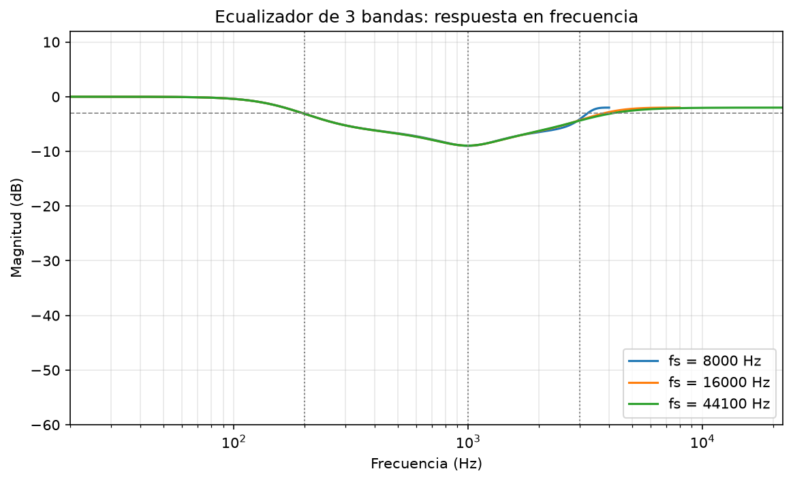
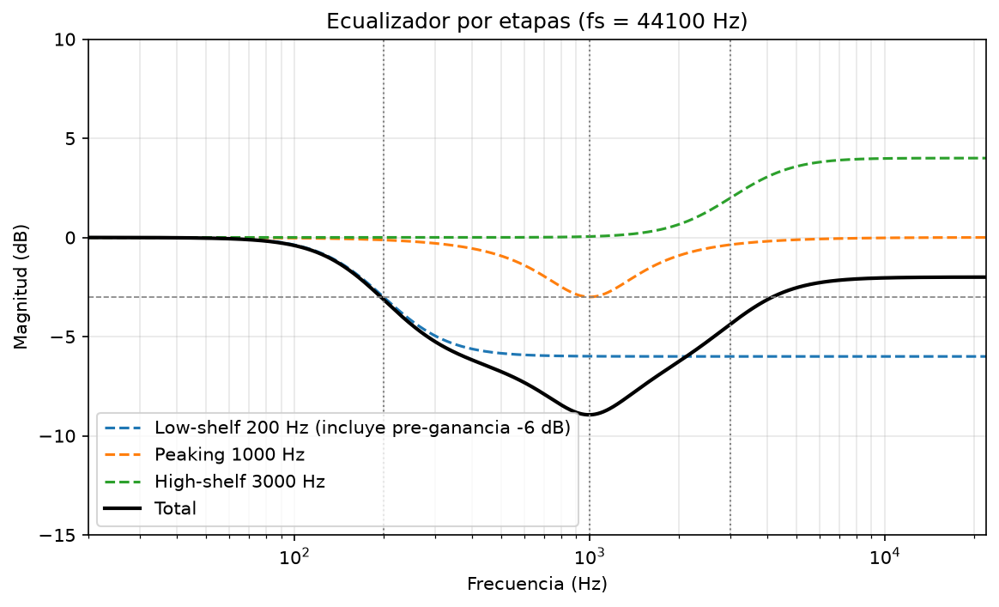
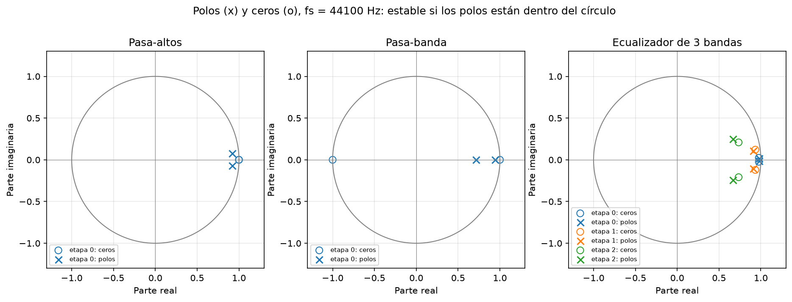
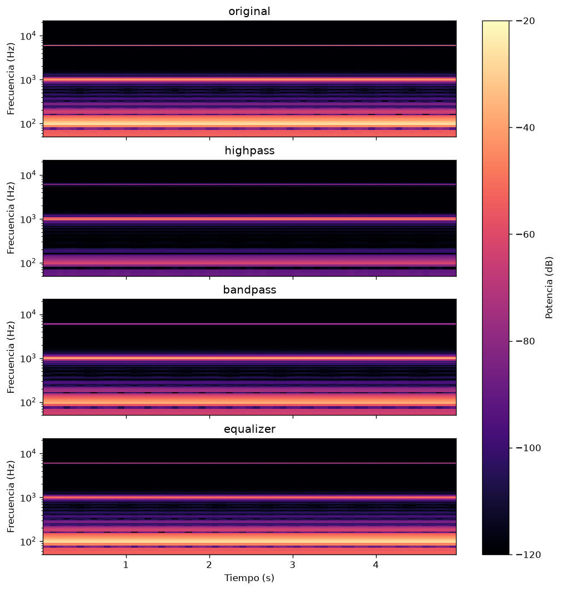
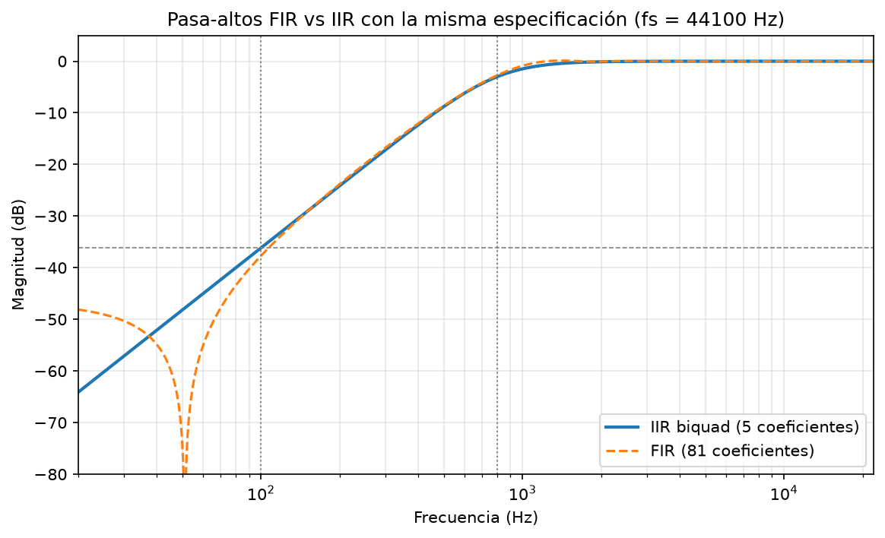

# Diseño de los filtros en punto flotante

Este documento describe el diseño de los filtros de audio del módulo DSP en
punto flotante, antes de pasarlos a punto fijo y a hardware.
Todo el código está en `dsp/model/` y las pruebas en `dsp/tests/`.

---

## 1. Decisiones de partida

- **Todo el procesamiento DSP se hace en hardware**, en una unidad dedicada en
  la FPGA y sin IPs de filtrado del catálogo. Así cada muestra se procesa en
  un número fijo de ciclos, sin depender de la carga del procesador, y el
  procesador queda libre para lo que el enunciado obliga a hacer en software
  (tarjeta SD, metadatos, interrupciones e interfaz). El costo es el uso de
  recursos de la FPGA, que se reporta por separado al sintetizar el módulo.
- **Filtros elegidos** (uno de cada grupo del enunciado):
  - Pasa-altos IIR.
  - Pasa-banda.
  - Ecualizador de 3 bandas.
- **Los tres filtros usan un mismo núcleo biquad** (filtro IIR de segundo
  orden). Cada filtro es una cascada de 3 biquads que solo cambia en sus
  coeficientes, que se cargan por registro.

Se descartaron el pasa-bajos (el enunciado lo plantea como FIR), el notch
(en música casi no se percibe) y la reverberación (necesita líneas de retardo
de miles de muestras en memoria, un bloque distinto al biquad).

---

## 2. El biquad

Un biquad tiene 5 coeficientes y calcula cada muestra de salida con:

```text
y[n] = b0·x[n] + b1·x[n-1] + b2·x[n-2] - a1·y[n-1] - a2·y[n-2]
```

Los coeficientes se calculan con las fórmulas del *Audio EQ Cookbook*
(R. Bristow-Johnson), implementadas en `dsp/model/biquad_design.py`. Se
devuelven normalizados (`a0 = 1`), que es la forma que usa el hardware.

---

## 3. Parámetros de los filtros

Los parámetros están definidos en un solo lugar, `dsp/model/filter_config.py`.
El número de filtro es el índice que usará el registro de control.

| N.º | Filtro | Etapas | Parámetros |
|---:|---|---|---|
| 0 | Pasa-altos | 1 | Butterworth, corte en 800 Hz, Q = 0,707 |
| 1 | Pasa-banda | 1 | 300 Hz a 3000 Hz (cortes a −3 dB), 0 dB en el centro |
| 2 | Ecualizador | 3 | low-shelf 200 Hz +6 dB → peaking 1 kHz −3 dB (Q = 1) → high-shelf 3 kHz +4 dB |

**Frecuencias de muestreo soportadas:** 8000, 16000 y 44100 Hz. Los
coeficientes cambian con cada una. Todas las frecuencias de diseño están por
debajo de 3 kHz para que también existan a 8 kHz, donde la frecuencia máxima
representable (Nyquist) es 4 kHz.

**Tres etapas fijas.** El hardware siempre procesa 3 etapas en cascada. A los
filtros de una sola etapa se les completan las otras dos con un biquad
identidad (`b0 = 1` y el resto en 0), que deja pasar la muestra sin cambios.
Así el hardware tiene un camino de datos fijo.

**Pre-ganancia del ecualizador.** Para que el ecualizador nunca supere 0 dB y
no sature, su entrada se atenúa 6 dB. Esa atenuación se incluye en los
coeficientes `b0`, `b1` y `b2` del low-shelf, por lo que no necesita un
multiplicador extra. Las ganancias totales quedan en:

| Banda | Ajuste | Con pre-ganancia |
|---|---:|---:|
| Graves | +6 dB | 0 dB |
| Medios (1 kHz) | −3 dB | −9 dB |
| Agudos | +4 dB | −2 dB |

**Bypass.** No es un filtro de esta configuración: será un bit del registro
de control que deja pasar la muestra sin tocar la MAC.

---

## 4. Respuesta en frecuencia

En las tres frecuencias de muestreo cada filtro se comporta igual, aunque sus
coeficientes sean distintos: las curvas de 8000, 16000 y 44100 Hz quedan
prácticamente una sobre otra, salvo cerca de la frecuencia de Nyquist de cada
una (fs/2), donde la respuesta cae.



*Pasa-altos: −3 dB en 800 Hz y pendiente de 40 dB por década por debajo del
corte.*



*Pasa-banda: 0 dB en el centro y −3 dB en 300 Hz y 3000 Hz. A 8 kHz el borde
superior cae antes por estar cerca de Nyquist (ver limitaciones).*



*Ecualizador de 3 bandas completo, con la pre-ganancia de −6 dB incluida.*

El ecualizador por etapas, a 44,1 kHz:



*Cada línea punteada es una etapa (low-shelf con la pre-ganancia, peaking y
high-shelf); la línea negra es el total: 0 dB en graves, −9 dB en 1 kHz y
−2 dB en agudos.*

**Limitaciones conocidas:**

- A 8 kHz el borde superior del pasa-banda (3000 Hz) queda en −6,4 dB en vez
  de −3 dB, por estar cerca de Nyquist. No se percibe como un problema.
- Un pasa-banda de segundo orden tan ancho tiene pendientes suaves (por
  ejemplo, −10 dB en 100 Hz). Si el efecto no se percibe suficiente, se puede
  usar una segunda etapa.
- Por la pre-ganancia, el ecualizador suena más bajo que el bypass,
  sobre todo en los medios.

---

## 5. Estabilidad

Un biquad es estable si sus polos están dentro del círculo unitario, lo que
equivale a `|a2| < 1` y `|a1| < 1 + a2`. Todas las etapas cumplen:

| fs (Hz) | Pasa-altos | Pasa-banda | Ecualizador (etapas 0 / 1 / 2) |
|---:|---:|---:|---:|
| 8000 | 0,6425 | 0,7638 | 0,9107 / 0,6389 / 0,6086 |
| 16000 | 0,8008 | 0,8623 | 0,9543 / 0,7934 / 0,4375 |
| 44100 | 0,9226 | 0,9462 | **0,9832** / 0,9189 / 0,7137 |

*Radio del polo más lejano de cada etapa (estable si es menor que 1).*

La etapa más cercana al límite es el low-shelf de 200 Hz a 44,1 kHz
(0,9832). Es la más sensible al redondeo de coeficientes en punto fijo.



*Polos (x) y ceros (o) de cada filtro a 44,1 kHz. Todos los polos quedan
dentro del círculo unitario; los del low-shelf (etapa 0 del ecualizador) son
los más cercanos al borde.*

---

## 6. Prueba con audio

`python dsp/model/filter_wav.py` aplica los filtros a un WAV de 16 bits y
reporta las muestras saturadas y el cambio de volumen. Con la opción
`--test-signal` usa una señal de prueba con tonos de 100 Hz, 1 kHz y 6 kHz:

| Filtro | Muestras saturadas | Efecto esperado |
|---|---:|---|
| Pasa-altos | 0 | elimina el tono de 100 Hz |
| Pasa-banda | 0 | atenúa los tonos de 100 Hz y 6 kHz |
| Ecualizador | 0 | baja 9 dB el tono de 1 kHz |



*Espectrograma de la señal de prueba (tonos de 100 Hz, 1 kHz y 6 kHz) sin
filtrar y con cada filtro, generado con `--spectrogram`.*

Los archivos de audio no se suben al repositorio.

---

## 7. Comparación FIR contra IIR

`python dsp/model/fir_vs_iir.py` diseña el pasa-altos FIR más corto que
cumple la misma especificación que el biquad: al menos ~36 dB de atenuación
en 100 Hz y no más de 1 dB de caída desde ~1,1 kHz.

| Concepto (por canal) | IIR biquad | FIR 8 kHz | FIR 16 kHz | FIR 44,1 kHz |
|---|---:|---:|---:|---:|
| Coeficientes | 5 | 17 | 31 | 81 |
| Multiplicaciones por muestra | 5 | 17 | 31 | 81 |
| Muestras guardadas | 4 | 16 | 30 | 80 |
| Retardo a 2 kHz | ~0,05 ms | 1,00 ms | 0,94 ms | 0,91 ms |



*Con la misma especificación, el biquad de 5 coeficientes y el FIR de 81
coeficientes tienen casi la misma respuesta en la banda de paso y en 100 Hz.*

**Decisión: biquad.** Ambos caben en el tiempo disponible (a 44,1 kHz y
50 MHz hay unos 1133 ciclos por muestra), así que la decisión se basa en:

1. **Registros y memoria:** 5 coeficientes y 4 muestras guardadas, contra
   hasta 81 y 80 por canal.
2. **Reutilización:** un mismo núcleo resuelve los tres filtros, incluido el
   ecualizador.
3. **Tamaño fijo:** el biquad siempre tiene 5 coeficientes; el FIR crece con
   la frecuencia de muestreo.

**Lo que se cede:** el FIR siempre es estable, tiene fase lineal y tolera
mejor el punto fijo. El biquad exige verificar la estabilidad y cuidar la
precisión de los coeficientes.

---

## 8. Tabla de coeficientes

Generada con `python dsp/model/export_coefficients.py`, que también la guarda
en CSV. Se muestran solo las etapas activas; las demás son identidad.

| fs (Hz) | Filtro | Etapa | b0 | b1 | b2 | a1 | a2 |
|---:|---|---:|---:|---:|---:|---:|---:|
| 8000 | 0 (pasa-altos) | 0 | +0.638946 | -1.277891 | +0.638946 | -1.142981 | +0.412802 |
| 8000 | 1 (pasa-banda) | 0 | +0.525095 | +0.000000 | -0.525095 | -0.698133 | -0.050191 |
| 8000 | 2 (ecualizador) | 0 | +0.520813 | -0.904895 | +0.400056 | -1.813452 | +0.829426 |
| 8000 | 2 (ecualizador) | 1 | +0.913589 | -0.995785 | +0.494664 | -0.995785 | +0.408253 |
| 8000 | 2 (ecualizador) | 2 | +1.129581 | +0.945511 | +0.336918 | +1.041644 | +0.370366 |
| 16000 | 0 (pasa-altos) | 0 | +0.800592 | -1.601185 | +0.800592 | -1.561018 | +0.641352 |
| 16000 | 1 (pasa-banda) | 0 | +0.348659 | +0.000000 | -0.348659 | -1.213322 | +0.302682 |
| 16000 | 2 (ecualizador) | 0 | +0.510932 | -0.954520 | +0.447759 | -1.906594 | +0.910766 |
| 16000 | 2 (ecualizador) | 1 | +0.945889 | -1.505413 | +0.683558 | -1.505413 | +0.629447 |
| 16000 | 2 (ecualizador) | 2 | +1.327733 | -0.780098 | +0.309720 | -0.334008 | +0.191364 |
| 44100 | 0 (pasa-altos) | 0 | +0.922561 | -1.845123 | +0.922561 | -1.839117 | +0.851128 |
| 44100 | 1 (pasa-banda) | 0 | +0.161483 | +0.000000 | -0.161483 | -1.661738 | +0.677034 |
| 44100 | 2 (ecualizador) | 0 | +0.504704 | -0.985241 | +0.481102 | -1.966096 | +0.966661 |
| 44100 | 2 (ecualizador) | 1 | +0.977274 | -1.825683 | +0.867097 | -1.825683 | +0.844371 |
| 44100 | 2 (ecualizador) | 2 | +1.480212 | -2.173723 | +0.862487 | -1.340347 | +0.509323 |

---

## 9. Formato de los coeficientes

- El coeficiente de mayor magnitud es `b1 = −2,1737` (high-shelf, 44,1 kHz),
  así que se necesitan **3 bits enteros** (incluido el signo): un formato
  Q3.x, con rango [−4, 4).
- Al redondear los coeficientes, todos los filtros siguen siendo estables
  tanto con 16 bits (Q3.13) como con 18 bits (Q3.15).
- Con 18 bits el error máximo de respuesta baja de −31 dB a −42 dB
  (peor caso: ecualizador a 44,1 kHz).

**Propuesta:** coeficientes de **18 bits en Q3.15**. Los
multiplicadores de los bloques DSP del Cyclone V son de 18×18, así que no
cuesta hardware adicional, y caben en los registros de 32 bits del bus.

**Mejora a aplicar al cuantizar:** en el pasa-altos, redondear `b0` y
calcular `b2 = b0` y `b1 = −2·b0`, para que `b0 + b1 + b2` siga siendo
exactamente 0 y el filtro elimine por completo la componente continua.

---

## 10. Cómo reproducir los resultados

```bash
source scripts/dsp/setup-env.sh

pytest dsp -v                                     # pruebas automáticas
python dsp/model/filter_config.py                 # coeficientes de cada filtro
python dsp/model/plot_response.py                 # gráficas de respuesta y polos
python dsp/model/filter_wav.py --test-signal --spectrogram
python dsp/model/filter_wav.py dsp/audio/cancion.wav --seconds 30
python dsp/model/fir_vs_iir.py                    # comparación FIR contra IIR
python dsp/model/export_coefficients.py           # tabla y análisis de formato Q
```

Las salidas se guardan en `dsp/output/`, que no se sube al repositorio. Las
imágenes de este documento son copias de `dsp/output/plots/` guardadas en
`docs/dsp/img/`. Para actualizarlas después de cambiar los filtros:

```bash
python dsp/model/plot_response.py
python dsp/model/filter_wav.py --test-signal --spectrogram
python dsp/model/fir_vs_iir.py
cp dsp/output/plots/*.png docs/dsp/img/
```

| Archivo | Contenido |
|---|---|
| `dsp/model/biquad_design.py` | fórmulas del Audio EQ Cookbook |
| `dsp/model/filter_config.py` | parámetros de los filtros y construcción de las etapas |
| `dsp/model/plot_response.py` | gráficas de respuesta en frecuencia y de polos y ceros |
| `dsp/model/filter_wav.py` | aplicación de los filtros a archivos WAV |
| `dsp/model/fir_vs_iir.py` | comparación FIR contra IIR |
| `dsp/model/export_coefficients.py` | tabla de coeficientes y análisis de formato Q |
| `dsp/tests/` | pruebas de estabilidad, respuesta y procesamiento de audio |
