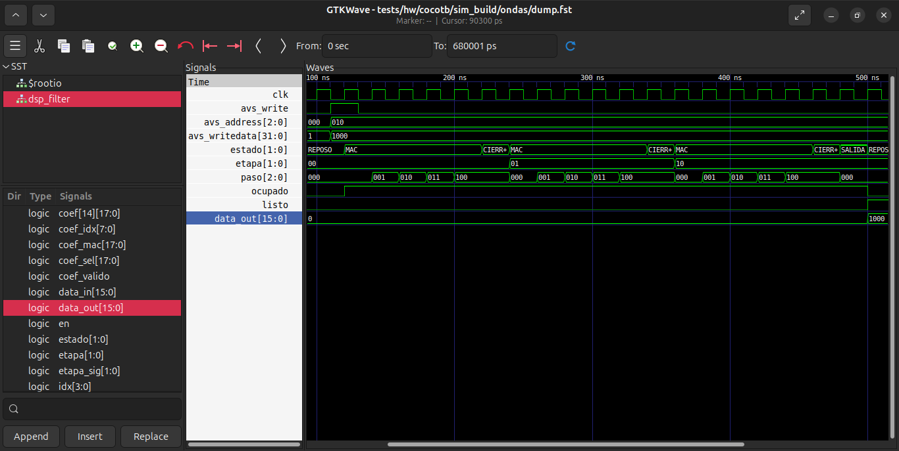
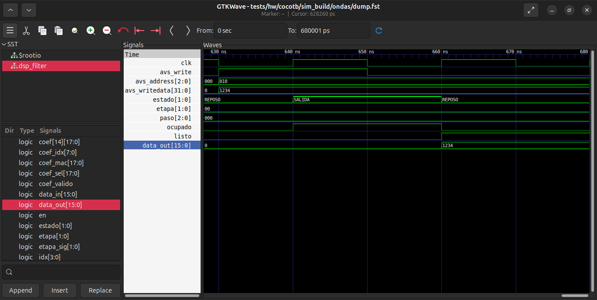

# Verificación aislada del hardware propio (simulación)

El enunciado exige verificar el hardware propio de forma aislada antes de integrarlo, y
documentar los casos de prueba y sus resultados. Estos testbenches son autoverificables: cada
uno compara las salidas contra lo esperado con `assert` (cada falla sale como `** Error` de Questa)
e imprime `RESULTADO <módulo>: OK` o el número de fallas. Módulos y testbenches en SystemVerilog.
`dsp_filter` tiene además una verificación completa en Python con cocotb, que lo compara contra
el modelo bit-exacto (sección [`dsp_filter` — cocotb](#dsp_filter--cocotb-testshwcocotb)).

```bash
tests/hw/sim.sh todos          # simula hex_ctrl y dsp_filter en Questa (consola)
tests/hw/sim.sh hex_ctrl -gui  # abre Questa con las formas de onda
```

El script carga `scripts/general/env.sh` (Questa y la licencia SALT) y compila desde
`Reproductor/ip/<módulo>/<módulo>.sv`.

## Entorno Docker: Verilator y cocotb

Además de Questa, el repo trae una imagen de Docker con Verilator, cocotb 2.0.1 y las
bibliotecas del modelo DSP (`dsp/requirements.txt`), para que todo el grupo haga el lint y las
simulaciones con las mismas versiones sin instalarlas. Se define en `scripts/hw/Dockerfile` y se
usa con `scripts/hw/docker.sh`:

```bash
scripts/hw/docker.sh lint              # lint de todo Reproductor/ip, igual que el CI
scripts/hw/docker.sh lint dsp_filter   # un solo módulo
scripts/hw/docker.sh shell             # terminal dentro del contenedor (en /repo)
scripts/hw/docker.sh <comando ...>     # cualquier comando, p. ej. verilator --version
```

- La imagen se construye sola la primera vez (varios minutos: compila Verilator) y otra vez solo
  si cambian el `Dockerfile` o `dsp/requirements.txt`.
- El repositorio se monta en `/repo` con el usuario actual: lo que se genere dentro del contenedor
  queda a nombre de uno, no de root. El comando corre en la misma carpeta desde la que se llamó.
- Requiere Docker sin `sudo` (usuario en el grupo `docker`).
- La imagen trae dos versiones de Verilator. `docker.sh lint` usa la de `apt` de Ubuntu 24.04
  (5.020), el mismo paquete que el CI, así que da los mismos avisos. cocotb usa la 5.040, compilada
  desde el código fuente, porque necesita la 5.036 o más nueva; es la que queda como `verilator`
  dentro del contenedor.

## `hex_ctrl` — `tb_hex_ctrl.sv`

| # | Caso | Se verifica |
|---|---|---|
| 1 | Tras el reset | Todos los displays apagados |
| 2 | Lectura de STATUS | ID = `0x4E58` |
| 3 | Tiempo 03:27 | HEX3..HEX0 = 0, 3, 2, 7 |
| 4 | Tiempo 59:59 y 00:00 | Extremos del rango |
| 5 | Lectura de TIEMPO | Se lee lo escrito (12:34) |
| 6 | Canción 7 | HEX5 = 0, HEX4 = 7 |
| 7 | Segundos = 61 | Satura en 59 y STATUS.FUERA_RANGO = 1; se limpia con un valor válido |
| 8 | EN_TIEMPO = 0 | HEX3..HEX0 apagados, HEX5..HEX4 siguen mostrando la canción |

## `dsp_filter` — `tb_dsp_filter.sv` (versión `0x02`)

Prueba con valores calculados a mano. Los bancos de coeficientes de prueba están al inicio
del archivo.

| # | Caso | Se verifica |
|---|---|---|
| 1 | Lectura de INFO | `0xD5F1020F`: ID, versión `0x02` y 15 coeficientes |
| 2 | Tras el reset | LISTO = 0, OCUPADO = 0, SATURO = 0 |
| 3 | Coeficientes de reset | Índices 0, 5 y 10 = `0x8000` (identidad), el resto 0; el índice 15 se lee como 0 |
| 4 | Escritura y lectura de los 15 coeficientes | Se leen extendidos en signo desde el bit 17 (extremos `0x1FFFF` y `0x20000` incluidos) aunque se escriba basura en los bits 31:18; con índice 20 la escritura se ignora |
| 5 | Identidad con EN = 1 | 0, 1, −1, 32767, −32768 y 1234 salen iguales tras las 3 etapas |
| 6 | Bypass (EN = 0) | La salida es igual a la entrada |
| 7 | Promedio (`b0 = b1 = 0,5` en la etapa 0) | 1000 → 500 y luego 2000 → 1500 (ejemplo de la sección 9.5 de la especificación) |
| 8 | Canales independientes | En el canal 1, 1000 → 500: no ve el historial del canal 0 |
| 9 | LIMPIAR | En el canal 0, 1000 → 500 otra vez: el historial quedó en cero |
| 10 | SATURO | Con `b0 ≈ 4`, 32767 satura la etapa 0: SATURO = 1 y la salida es 32767; escribir COEF_DATA lo borra |
| 11 | DATA_IN con OCUPADO = 1 | La segunda de dos escrituras seguidas se descarta |
| 12 | Lectura de CTRL | EN y CANAL se leen de vuelta; LIMPIAR se lee como 0 |

## `dsp_filter` — cocotb (`tests/hw/cocotb/`)

Verificación completa del filtro contra el modelo bit-exacto (`dsp/model/fixed_model.py`), en
Verilator 5.040 con cocotb 2.0.1 dentro del entorno Docker. El testbench de Questa de arriba queda
como prueba de humo con valores calculados a mano.

```bash
scripts/hw/docker.sh pytest tests/hw/cocotb             # resumen
scripts/hw/docker.sh pytest -s tests/hw/cocotb          # con la salida completa de cocotb
COCOTB_TEST_FILTER=tiempos scripts/hw/docker.sh pytest -s tests/hw/cocotb   # solo esas pruebas
COCOTB_RANDOM_SEED=<semilla> scripts/hw/docker.sh pytest -s tests/hw/cocotb # repite una corrida
ONDAS=1 scripts/hw/docker.sh pytest tests/hw/cocotb     # graba sim_build/ondas/dump.fst
```

| Archivo | Contenido |
|---|---|
| `test_dsp_filter.py` | Punto de entrada de pytest: compila el RTL con Verilator y corre las pruebas de cocotb |
| `dsp_filter_bus.py` | Acceso al módulo como lo hace el ARM: reloj, reset, lectura y escritura por Avalon, carga de coeficientes y `procesar()` (con la cuenta de ciclos) |
| `dsp_filter_tests.py` | Las pruebas de cocotb |

### Casos

| Grupo | Prueba | Se verifica |
|---|---|---|
| Humo | `info_e_identidad` | INFO = `0xD5F1020F`; con los coeficientes de reset la salida es igual a la entrada |
| Vectores (12) | `vectores/fs=…/modo=…` | Los 12 juegos de `dsp/vectors/` (8, 16 y 44,1 kHz; pasa-altos, pasa-banda, ecualizador y bypass): 3700 muestras cada uno, iguales a `expected.hex` |
| Modelo (4) | `estereo_aleatorio/filtro=…` | Ruido estéreo intercalado a 44,1 kHz (señales distintas en cada canal, tramos a escala completa), 1500 pares por filtro, comparado muestra por muestra con el modelo; STATUS.SATURO igual al modelo |
| | `cambio_de_filtro` | Secuencia estéreo continua: pasa-altos → pasa-banda → bypass sin recargar → pasa-banda con el estado que tenía → LIMPIAR → ecualizador, comparada con el modelo y con SATURO revisado en cada tramo |
| Tiempos y protocolo (6) | `tiempos_filtro` | Sección 10.1 de la especificación: OCUPADO en los ciclos 1-19, FSM con 5 ciclos de MAC y 1 de CIERRE por etapa y SALIDA en el ciclo 19, LISTO y DATA_OUT desde el ciclo 20 |
| | `tiempos_bypass` | Sección 10.3: con EN = 0, SALIDA en el ciclo 1 y LISTO desde el ciclo 2 |
| | `bypass_conserva_estado` | Una muestra en bypass no cambia `x1`, `x2`, `y1`, `y2` ni el residuo de ningún canal |
| | `carga_coeficiente` | Sección 10.2: escribir COEF_DATA borra el estado de los dos canales y SATURO en el mismo flanco, con OCUPADO en 0 |
| | `protocolo_status` | STATUS leído justo después de escribir DATA_IN da OCUPADO = 1 (nunca el LISTO de la muestra anterior); LISTO y DATA_OUT se mantienen hasta la siguiente muestra |
| | `descarte_data_in` | Una escritura de DATA_IN con OCUPADO = 1 se ignora: LISTO llega en el ciclo 20 de la primera muestra con su resultado |

### Resultados

Corrida del 2026-11-28: **23 de 23 pruebas pasan** (47 s de simulación, 54 s con la compilación).
Son 44 400 muestras de los vectores y 12 400 de ruido estéreo, todas iguales al modelo bit-exacto,
más las pruebas de tiempos ciclo a ciclo.

Para comprobar que las pruebas detectan errores se rompió el RTL a propósito (una rotura a la vez,
deshecha después):

| Rotura en `dsp_filter.sv` | Pruebas que fallaron |
|---|---|
| Salida invertida (`data_out <= ~salida`) | `info_e_identidad` (la única prueba en ese momento) |
| `a1·y1` y `a2·y2` se suman en vez de restarse | Los 9 vectores de pasa-altos, pasa-banda y ecualizador; los de bypass pasan |
| Los dos canales comparten el estado (`canal_act <= 1'b0`) | `estereo_aleatorio` y `cambio_de_filtro`; los vectores (solo canal 0) pasan |
| Escribir COEF_DATA no borra el estado | `carga_coeficiente` |

La segunda rotura no la detecta el testbench de Questa, porque en sus filtros de prueba `a1` y
`a2` valen 0; la tercera y la cuarta tampoco las detectan los vectores.

### Formas de onda

Capturas de GTKWave de `sim_build/ondas/dump.fst` (pruebas `tiempos_filtro` y `tiempos_bypass`).
`estado`: 0 = REPOSO, 1 = MAC, 2 = CIERRE_ETAPA, 3 = SALIDA. Coinciden con los diagramas de las
secciones 10.1 y 10.3 de la [especificación](../../docs/dsp/especificacion-modulo.md).

**Una muestra con el filtro** (identidad, 1000 → 1000): la escritura de DATA_IN se acepta en el
flanco de 120 ns; OCUPADO dura 19 ciclos, en los que `etapa` va de 0 a 2 y `paso` de 0 a 4 en cada
una, con un ciclo de CIERRE_ETAPA entre etapas y SALIDA al final; LISTO sube y DATA_OUT toma el
resultado 20 ciclos (400 ns) después.



**Una muestra en bypass** (1234 → 1234): la escritura se acepta en el flanco de 640 ns, la FSM pasa
directo a SALIDA y LISTO sube con DATA_OUT = 1234 dos ciclos (40 ns) después.



## Resultados

Simulación del 2026-11-28 con Questa Altera Starter FPGA Edition 2025.2 (`tests/hw/sim.sh todos`)
y lint con Verilator 5.040 (`scripts/hw/docker.sh lint`):

| Módulo | Casos | Questa | Lint |
|---|---|---|---|
| `hex_ctrl` | 8 | OK, 0 errores y 0 avisos | OK |
| `dsp_filter` (versión `0x02`) | 12 | OK, 0 errores y 0 avisos | OK |
